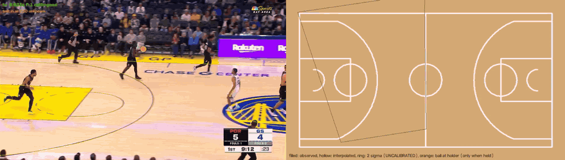
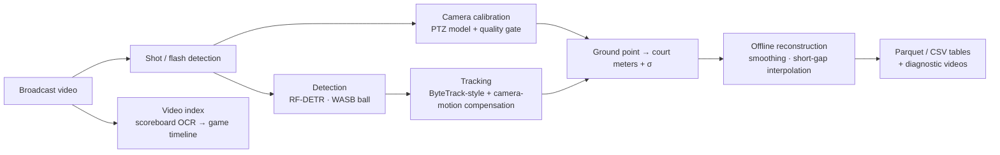
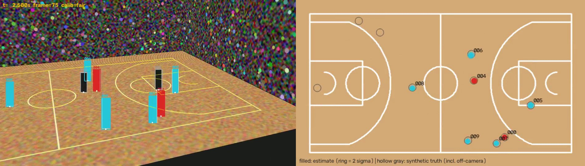

# nbatrack: NBA broadcast video → court-coordinate tracking data

Turns ordinary NBA broadcast video into time-synchronized player and ball positions on a canonical court, in meters. Every position carries an uncertainty and a status (observed, interpolated or unknown). The system never invents a position it has no evidence for.

> **Status: work in progress (October 2026).** The pipeline runs end to end on real broadcast footage, including a 113-second multi-camera clip. Long-term player identity is the main open problem. **No accuracy against human-reviewed ground truth has been measured yet.** The results below say which numbers are measured and which are proxies. See [Limitations](#limitations-and-open-problems).


<sub>Real broadcast, 15 s, camera panning about 28° across midcourt. **Left:** tracked players. Box color is the team label from jersey color (black = referee), and court lines are projected through the estimated camera. **Right:** the same players on a top-down court in meters: filled = observed, hollow = interpolated, ring = 2σ uncertainty, tails = last 1 s, orange = ball holder. The gray outline is the camera's field of view.</sub>

<!-- Full-quality video: drag docs/media/demo_side_by_side.mp4 into the GitHub web editor here and paste the generated user-attachments URL on its own line. -->


## What it does



1. **Shot handling.** Camera cuts and single-frame photographer flashes are detected. Calibration restarts at a cut; flash frames reuse the previous camera.
2. **Detection.** Players with RF-DETR Small, exported to ONNX and run on CPU or DirectML. The ball with WASB, a basketball-specific heatmap model.
3. **Camera calibration.** A pan-tilt-zoom camera with a fixed center is fitted to a few landmark clicks on one keyframe. It is then propagated forward and backward through the video using KLT motion on static pixels plus alignment to the painted court lines.
4. **Calibration quality gate.** Each frame's camera is graded *accepted*, *uncertain* or *rejected* from three signals: line-alignment inliers, agreement with the detected floor region, and plausible camera motion. Rejected frames keep image-space tracking but get no court coordinates.
5. **Tracking.** A ByteTrack-style multi-object tracker with camera-motion compensation and gating in court space. Team and referee labels come from jersey color.
6. **Projection.** The bottom of each box is back-projected to the floor plane, with a first-order uncertainty (σ).
7. **Offline reconstruction.** Kalman + RTS smoothing. Gaps of up to 1 s are filled with new rows marked `interpolated`; raw observations are never overwritten.
8. **Export.** Schema-validated Parquet/CSV tables, plus annotated and side-by-side (video | top-down court) diagnostic videos.

A separate **video indexing engine** reads the broadcast scoreboard (game clock, shot clock, score) to build a game timeline and candidate possessions, with a browser UI for reviewing them (see [below](#video-indexing-engine)).

## Results so far

Each number is labelled with how it was obtained:
- **measured**: computed by the code in this repo;
- **proxy**: a self-consistency statistic, not accuracy;
- **visual check**: crops inspected by eye, not independent ground truth.

### Calibration quality gate
The original rule (line inliers ≥ 0.55) accepted most wrong camera solutions. The gate now also requires floor-region agreement and plausible camera motion.

| Test set | Old rule | Current gate | Evidence |
|---|---|---|---|
| Wrong solutions that occurred naturally on unseen frames (272) | 85% accepted | **3.3% accepted** | measured against verified reference poses |
| Deliberately perturbed wrong poses (980 real + 80 synthetic) | 27.6% accepted | **0.2% accepted** (2/1060) | measured |
| Verified correct poses | — | 17/17 accepted; 1/98 correct real poses rejected | measured |
| Main-camera frames of the 113 s video accepted | — | **99.2% / 99.85%** (two segments) | measured; no drift visible over 97 s (visual check) |

The regression tests for the gate are built from the real failure cases (`tests/unit/test_calibration_gates.py`). One threshold fix was made after seeing the unseen-frame results, so that 3.3% is partly post-hoc.

### Ball and players
- **Ball.** An old clutter rule deleted every ball in flight, because a high ball projects far off the court. After the fix:
  - missing-ball frames fell from 35.7% to 29.2%, and the longest gap from 2.39 s to 1.30 s (measured);
  - all 48 sampled restored frames showed the real ball (visual check).
- **Spectators and referees as players.** A check of box height against a standing person's expected height at that court point stops front-row spectators being placed on the court. On a 17 s test interval, frames with more than 10 "players" fell from 22% to 3% (proxy).

### Performance (laptop CPU: Ryzen 7 7840HS, no NVIDIA GPU)
- Full pipeline: ≈ 0.84 s/frame. The 113 s video took 94 min; peak memory was 3.4 GB.
- Detection is 60% of the time. Stage A checkpoints every 1000 frames, and a resumed run equals an uninterrupted one (tested).

### Video indexing (113 s video)
- **Scoreboard fields readable:** game clock, shot clock and period in 100% of samples; scores in about 98% (score animations are reported as unreadable, not guessed).
- **Game clock:** 110/110 consecutive readings step by exactly −1 s (self-consistency).
- **Speed:** indexing runs at 0.44× real time on CPU, versus about 50× real time for tracking.

### Synthetic test bench
A broadcast simulator renders a court, crowd and moving players with a known camera, so every stage can be checked against exact ground truth. Calibration-model comparisons, quality-flag studies and tracker variants are measured here. These measurements do not stand in for real-footage accuracy.



### Not measured yet
- Detection precision/recall.
- HOTA / IDF1 tracking metrics.
- Court-position error in meters.
- Possession boundary precision/recall.

The annotation and evaluation tooling for these exists: CVAT packages plus TrackEval, and the evaluator refuses unreviewed annotations. The human-reviewed annotations are in progress.

## Design principles
- **Never invent data.** Positions are `observed_projected`, `interpolated` or `unknown`. Raw detection coordinates are never overwritten. Off-screen positions are left unknown, not guessed.
- **Report uncertainty.** Each court position has a σ, and each frame has a calibration grade. Frames that fail calibration keep image-space tracking without court coordinates.
- **Keep errors separable.** Detection, ground-contact, calibration and final-coordinate errors are evaluated separately. No meter-error claims are made from points projected through the same camera model that is being evaluated.
- **Test hypotheses against data.** The fixed-center PTZ camera model is treated as a hypothesis. It sits behind the same interface as a free camera and a plain homography, and a cross-validated model-selection test (`calib/select.py`) compares them.
- **Validate honestly.** Tuning data and unseen validation frames are kept separate. Calibration is tested on naturally occurring wrong solutions, not only synthetic perturbations.

## Getting started

Requires Python 3.11.
```bash
pip install -e ".[video,inference,dev]"
pytest                                              # 121 tests; synthetic data, no footage needed
nbatrack synth-demo --out outputs/samples/demo      # end-to-end run on a synthetic broadcast
```

**Real video** (footage is not included; use video you have the right to process):
```bash
pip install rfdetr                                   # only for the one-time ONNX export
python tools/export_rfdetr.py --size small --shape 512 896
nbatrack calibrate clip.mp4 --frame 0 --out kf_0000.json      # click 4–6 court landmarks
nbatrack process clip.mp4 --keyframe kf_0000.json --video-id clip --out outputs/real/clip \
    --provider cpu --ball-detector rfdetr
nbatrack retrack outputs/real/clip --ball-detector rfdetr --render   # re-run tracking from cached detections
```
`--ball-detector rfdetr` uses the general detector for the ball. The WASB ball model is better, but its weights have no stated license, so it is optional and for research use only (see [LICENSES](docs/LICENSES.md)).

Developer workflow, evaluation tools and the indexing commands are in [docs/DEVELOPMENT.md](docs/DEVELOPMENT.md).

## Video indexing engine
The tracking pipeline is too slow to run over full games (about 50× real time on CPU), so a lighter engine first turns the broadcast into a searchable timeline:
- **Scoreboard reader.** Glyph-template OCR of the game clock, shot clock and score. No model is downloaded: a person labels the glyph clusters once per broadcast graphics package. A field is reported only when the match is confident and stable over 3 readings.
- **Game timeline.** It maps video time to game clock, finds clock stoppages, score changes and shot-clock resets, and proposes candidate possession boundaries with confidences.
- **Review UI.** A local HTML page for seeking, editing, confirming or rejecting events and exporting clips. Automatic output is never edited in place.

The index and the tracking tables share the same video presentation timestamps, so later analysis can join *(event interval) × (tracking rows)* by time. Details: [docs/VIDEO_INDEXING.md](docs/VIDEO_INDEXING.md).

## Limitations and open problems
1. **Long-term identity is the biggest gap.** In 97 s of play the tracker produces about 48 player tracks, where 10 is ideal. Players also swap IDs at close crossings, because teammates cannot be told apart by jersey color. The next step is an appearance re-ID model plus the reviewed annotations needed to tune it safely.
2. **Calibration after a camera cut** needs a manual keyframe. Automatic re-initialization was tried and rejected: it fitted the court onto the stands.
3. **Ball coverage** drops in crowded dribbles and wide views; it is still 25–30% missing on the long clip. Positions are 2D only (no ball height).
4. **Ground contact** uses the bottom of the bounding box. A pose-based foot estimate is planned.
5. **The scoreboard reader is per graphics package**, and replay detection is minimal.

## Project layout
```
src/nbatrack/
  court/     NBA court geometry in meters (32 landmarks), rendering
  calib/     pinhole + PTZ camera, homography, fitting, line alignment, propagation,
             quality grading, PTZ-vs-free model selection, manual landmark tool
  detect/    RF-DETR (ONNX) and WASB ball detectors
  track/     Kalman, tracker, ball tracking, teams, appearance, offline reconstruction
  project/   ground point → court coordinates + σ
  filter/    temporal smoothing and plausibility flags
  segments/  camera segments, overlay masking
  index/     shot detection, scoreboard OCR, game timeline, events schema
  export/    schema-validated Parquet/CSV writers
  eval/      MOT metrics, TrackEval bridge, ground-truth evaluation, calibration studies
  synthetic/ broadcast simulator with ground truth (scene, players, camera, rendering)
  annot/     CVAT import/export
  pipeline/  real-video and synthetic pipelines
tools/       experiments, evaluation, CVAT setup, index server and UI
tests/       unit + integration tests
docs/        design documents and reports
```

## Documentation
| Document | Contents |
|---|---|
| [PHASE1_ARCHITECTURE.md](docs/PHASE1_ARCHITECTURE.md) | Architecture and design decisions |
| [COORDINATE_SYSTEM.md](docs/COORDINATE_SYSTEM.md) | Court coordinate system and landmarks |
| [DATA_SCHEMA.md](docs/DATA_SCHEMA.md) | Output tables and position states |
| [OFFLINE_RECONSTRUCTION.md](docs/OFFLINE_RECONSTRUCTION.md) | Stitching, interpolation, off-screen inference design |
| [EVALUATION.md](docs/EVALUATION.md) | Evaluation protocol |
| [VALIDATION_LOG.md](docs/VALIDATION_LOG.md) | Every measured number and how to reproduce it |
| [REAL_VIDEO_REPORT.md](docs/REAL_VIDEO_REPORT.md), [OVERNIGHT_REPORT.md](docs/OVERNIGHT_REPORT.md) | Experiment reports on real footage |
| [OPEN_SOURCE_TRACKING_REVIEW.md](docs/OPEN_SOURCE_TRACKING_REVIEW.md) | Review of existing basketball-tracking projects |
| [VIDEO_INDEXING.md](docs/VIDEO_INDEXING.md) | Video indexing engine design and results |
| [LICENSES.md](docs/LICENSES.md) | Third-party license register |

## Third-party components
Built on NumPy, SciPy, OpenCV, PyAV, pandas/pyarrow, ONNX Runtime and TrackEval. Detection uses [RF-DETR](https://github.com/roboflow/rf-detr) (Apache-2.0); the optional ball model is [WASB-SBDT](https://github.com/nttcom/WASB-SBDT) (code MIT, weights license not stated). The main code does not use AGPL components. Full register: [docs/LICENSES.md](docs/LICENSES.md).

The demo excerpt at the top comes from an NBC Sports Bay Area broadcast (Portland at Golden State). All rights belong to the NBA and the broadcaster, and it is shown only to demonstrate the research output. No other broadcast footage is included in this repository.

## License
Copyright © 2026 Ming Chen. All rights reserved.

This repository is shared publicly as a portfolio project so the code can be read and reviewed. No license is granted to use, copy, modify or distribute it. Please get in touch if you would like to use any part of it.

## Author
Ming Chen
